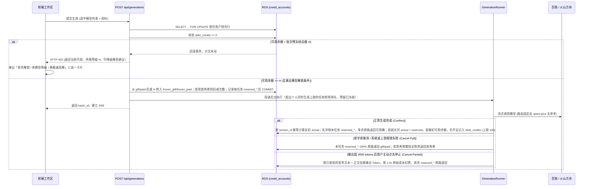

# 计费单位经济重构与防透支预授权改造方案

**日期**：2026-11-12  
**状态**：已上线（2026-11-12）  
**关联前序文档**：`doc/20260614/billing-system-plan.md`、`doc/20260615/billing-finance-enhancements-record.md`、`doc/20261015/training-consent-report-discount-plan.md`

---

## 一、背景与线上账本诊断

随着多模型并行生成、深度思考模型上线以及小红书 KOC 投放启动，对现网 RDS 真实历史账本（206 个已生成版本、139 笔消费结算、247 个生成任务）进行全量审计后，确认当前计费体系在高并发放量下存在四项结构性现金流风险：

1. **三重让利连乘导致大额充值现金毛利倒挂**
   - 现状为：主力模型倍率 `1.2x` × 训练授权默认折扣 `0.90`（现网授权开启率 100%）÷ 充值赠币系数（¥50 送 10%、¥100 送 15%、¥500 送 25%）× 微信实收净率 `99.4%`。
   - 尚未计入废片损耗时，¥50 / ¥100 / ¥500 三个档位每消耗 ¥1.00 上游真实算力，平台仅能收回 **¥0.976 / ¥0.934 / ¥0.859** 净现金；叠加废片损耗后全线净贴钱。
   - 小额生成向下取整穿底：现网已出现 `qwen-plus` 原始成本 ¥0.0414，标准价 5 积分经 `floor(5 × 0.9)` 实收 4 积分（¥0.0400），余额充足情况下直接亏本 `-3.4%`。

2. **免费获客算力敞口过大（单名未付费注册用户可消耗 ¥9.87 真实现金）**
   - 匿名免费 2 轮（实测约 ¥0.57）+ 短信验证（¥0.045）+ 注册无条件赠送 1,000 积分并直接开放全部高价旗舰模型（可烧 ¥9.26 上游预存款）。按 5% 付费转化率折算，单个付费用户的免费算力获客成本高达约 ¥188，首充无法回本。

3. **「先上车后补票」并发透支窗口（现网已真实触发）**
   - 前置校验 `ensure_can_start_batch` 仅判断当时 `paid_balance + gift_balance > 0`，既未加行锁，也未预冻结积分或统计在途排队任务；结算时 `deduct = min(credits, total_balance)` 在余额归零后静默免单。
   - 2026-11-11 现网真实案例：同一用户在 11-11 00:10～00:53（北京时间）分四次提交了 4 个 9 模型批次，每次提交时余额都大于 0，全部放行，积分要到出稿后才扣。这 36 个任务当晚卡住，13:51 后台执行器上线时被扫尾一起自动重跑（25 个任务记有 `restarted` 事件）。重跑中 `glm-5.3` 扣完最后 237 积分后，批次 `d88e9935` 里的 `qwen3.8-max` 消耗 **¥3.80** 真实算力却实扣 **0 积分**。
   - 结论：漏洞不在「同一时刻连发」，而在「提交只查余额 > 0、出稿才扣」。提交时间分散、后台重跑、排队任务都会把余额扣穿；剩 1 积分的账号也能排进任意多个任务。

4. **代码级隐性算力漏损（账外成本，均已修补，见 5.4）**
   - 技能分类路由（`selector.py`）直接调用用户所选旗舰模型且开启深度思考去选一个分类词，12 秒超时丢弃且不记成本；
   - Tailwind 违规自动重跑在第二轮前清空了 `generation_usage = None`，抹掉了首轮数万 Token 的 `6001` 算力成本记录。

---

## 二、选定方案总览

经五套财务沙盘对比决策，本期确定采用 **「方案二：双轨分层稳健增长型」+「P90 动态预授权冻结与小额欠费兜底（TCC）」+「修补三处算力漏损」**：

| 维度 | 改造前（现状） | 改造后（本期方案） | 预期财务与运营效果 |
| --- | --- | --- | --- |
| 模型定价倍率 | 主力 1.2x / 顶配 1.5x | **轻量 2.0x / 主力 1.65x / 顶配 1.80x** | 轻量单次仍仅 0.18~0.50 元，全线恢复健康毛利 |
| 训练授权优惠 | 90 折，向下取整无底线 | **92 折，向下取整 + `1.25x` 原始成本硬地板** | 既保留每次可见整数立减，又彻底消灭小额负毛利 |
| 充值套餐返赠 | 0% / 10% / 15% / 25% | **首充 ¥19.9(+5%) / ¥50(+6%) / ¥100(+10%) / ¥500(+15%)** | ¥500 档叠满 92 折、15% 赠送、0.6% 手续费和 3% 损耗后，主力模型净现金毛利约 21%，顶配约 28%，轻量约 35%（由费率公式直接算出） |
| 匿名与注册补贴 | 匿名 2 轮；注册送 1000 积分全放开 | **匿名 1 轮；注册送 450 积分 + 1 次旗舰双模首秀券** | 保留旗舰首秀转化钩子，单注册用户免费成本从 ¥9.87 降至 **约 ¥3.1（降约 69%）**，算法见 3.1 |
| 防透支机制 | 仅判余额 > 0，扣光免单 | **预授权冻结 + 多退 + 超长页 ≤100 积分欠费下次充抵** | 单任务超出预留的部分，用户最多欠 ¥1.00；再超出的极端尾差由平台承担（见 4.2） |
| 取消任务规则 | 点击停止一律 0 积分 | **首字前或系统报错全退；吐字超 2000 tok 主动停止按 1.0x 成本保底** | 封堵黑产卡点取消白嫖算力，系统故障仍由平台全额兜底 |

> **协议兼容性核验**：现行《积分充值服务协议》（2026-10-15 生效）第 1.4 条约定「各项服务消耗的积分，以生成前页面上的提示为准……享受授权积分优惠（优惠幅度以平台当前规则为准）」。调整倍率、授权优惠幅度和套餐**不需要老用户重签**，生成前展示预计积分即可。
> 但「中途停止按已生成部分收费」和「超出预留记欠费、欠费未补不能开新一轮」是新的扣费规则，第 1.4 条覆盖不到：同步修订《积分充值服务协议》写入这两条即可，界面不额外加文字说明，避免变繁琐（见 4.2 第 6 条）。
>
> **测算口径说明**：配套画布里的综合毛利、月度现金流使用了假设的模型组合（轻量 15% / 主力 60% / 顶配 25%）、客单价和当月核销比例，只作方案间相对比较，不是预测值。

---

## 三、定价、补贴与充值套餐调整明细

### 3.1 模型分层倍率与 P90 预冻结基准表

按现网实测单次成本分位数校准（`1 元 = 100 积分`）：

| 分层 | 模型 Key | 展示名称 | 实测均值成本 | 实测 P90 成本 | 新倍率 | 标准预冻结积分 | 授权(92折)预冻结 | 未充值可用性 |
| --- | --- | --- | ---: | ---: | ---: | ---: | ---: | --- |
| 轻量引流层 | `qwen-plus` | 通义千问 3.8 Flash | ¥0.09 | ¥0.16 | **2.00x** | 35 | 33 | 匿名 + 注册可用 |
| 轻量引流层 | `glm-5.3-flash` | 智谱 GLM-5.3 Flash | ¥0.13 | ¥0.20 | **2.00x** | 45 | 42 | 注册可用 |
| 轻量引流层 | `doubao-code` | 豆包 Seed 2.1 Turbo | ¥0.19 | ¥0.25 | **2.00x** | 55 | 51 | 匿名 + 注册可用 |
| 轻量引流层 | `deepseek-v4.1-flash` | DeepSeek V4.1 Flash | ¥0.25 | ¥0.41 | **2.00x** | 85 | 79 | 匿名 + 注册可用 |
| 主力默认层 | `deepseek-v4-pro` | DeepSeek V4 Pro | ¥0.46 | ¥0.56 | **1.65x** | 95 | 88 | 充值后解锁 |
| 主力默认层 | `doubao` | 豆包 Seed 2.1 Pro | ¥0.47 | ¥0.61 | **1.65x** | 105 | 97 | 首秀券 1 次 / 充值解锁 |
| 主力默认层 | `qwen` | 通义千问 3.8 Max | ¥1.30 | ¥1.95 | **1.65x** | 325 | 299 | 首秀券 1 次 / 充值解锁 |
| 顶配高思考层 | `glm-5.3` | 智谱 GLM-5.3 | ¥1.34 | ¥1.87 | **1.80x** | 340 | 313 | 充值后解锁 |
| 顶配高思考层 | `kimi-k3.1-pro` | Kimi K3.1 Pro | ¥2.62 | ¥3.31 | **1.80x** | 600 | 552 | 充值后解锁 |

- **超长资料压缩附加预留**：当上传资料提取文本超过 `5,000` 字符需调用压缩模型时，本批次额外增加预冻结 **`15` 积分**。
- **预留额 = 实测 P90 原始成本 × 新倍率，向上取整到 5**。`qwen` 当前授权期样本 P90 为 ¥1.95，全量 23 个样本 P90 为 ¥1.85，按前者取 325。
- **样本量很小，以上预留额都是临时值**：当前授权期样本 `qwen` 13 个、`glm-5.3` 13 个、`kimi-k3.1-pro` 和 `glm-5.3-flash` 各 4 个。上线后每周按最近 30 天真实结算重算 P90 并更新 `model_hold_credits`；同时统计「实扣超出预留」的任务占比，目标不高于 10%。
- **已知尾部风险**：`qwen` 历史最高单次 ¥3.80，按 1.65x 约 627 积分，超出预留约 300；用户最多记 100 积分欠费，其余约 200 积分由平台承担。
- **首秀金额衔接**：新注册用户获赠 `450` 积分 + `1` 次旗舰双模首秀资格。仍有首秀券或已充值时，默认勾选 `qwen + doubao`，授权预冻结为 `299 + 97 = 396` 积分（`< 450`），一次跑通。按均值实扣约 `268` 积分（`qwen` 197 + `doubao` 71），剩余约 `180` 积分，够用轻量双模（约 52 积分/轮）再微调 3 轮左右。
- **首秀用完后的默认勾选**：从未充值且 `free_flagship_batches_remaining = 0` 时，默认改为 `qwen-plus + doubao-code`。本机若还存着旗舰勾选，打开页面时整组改回这两个轻量模型。可用积分被在途任务全部冻住、且没有欠费时，再次提交直接进入充值页。
- **单注册用户免费成本**：首秀原始成本约 ¥1.77 + 剩余 182 积分按轻量 1.84 倍（2.0 × 0.92）折回原始成本约 ¥0.99 + 短信 ¥0.045 + 匿名 1 轮轻量双模约 ¥0.28，合计约 **¥3.1**（现状 ¥9.87）。

### 3.2 结算取整与成本地板公式

对单次成功生成版本（原始总成本 `C` 元，含主生成与分摊的路由/压缩成本，模型倍率 `M`）：

1. **标准积分**：`standard = max(ceil(C × M × 100), 1)`
2. **成本安全地板**：`cost_floor = max(ceil(C × 1.25 × 100), 1)`
3. **授权实收积分**（`training_consent == 'granted'`）：
   `charged = max(floor(standard × 0.92), cost_floor, 1)`
   `discount_credits = max(standard - charged, 0)`

### 3.3 充值套餐阶梯调整

> **复式记账守恒红线**：`2001 预收账款-充值积分` 按实付人民币入账、按 `paid_used × 0.01` 核销，因此任何套餐必须严格满足 **`base_credits == amount_cny × 100`**，所有优惠让利一律放入 `bonus_credits`（走 `6601 / 2002` 赠送负债桶）。

| 套餐 Key | 名称 | 售价（元） | 基础付费积分 (`paid`) | 赠送积分 (`gift`) | 到账总积分 | 赠币比例 | 购买限制与说明 |
| --- | --- | ---: | ---: | ---: | ---: | ---: | --- |
| `first_19_9` | 首充体验包 | **19.90** | 1,990 | 100 | **2,090** | +5.0% | 仅 `total_recharged_credits == 0` 首充可见可买 |
| `starter_20` | 轻量包 | **20.00** | 2,000 | 0 | **2,000** | 0% | 已首充用户的日常小额补包（原 `starter_10` 下架停售，旧单不受影响） |
| `basic_50` | 基础包 | **50.00** | 5,000 | 300 | **5,300** | +6.0% | 主推档，约可跑 18～20 轮主力双模或 100+ 轮轻量微调 |
| `pro_100` | 专业包 | **100.00** | 10,000 | 1,000 | **11,000** | +10.0% | 高频创作者与多模型对比推荐 |
| `flagship_500` | 旗舰包 | **500.00** | 50,000 | 7,500 | **57,500** | +15.0% | 工作室/重度使用档（原赠 12,500 下调至 7,500） |

### 3.4 存量老用户平滑过渡规则

- 已充值老用户（`total_recharged_credits > 0`）：直接视为已解锁全部旗舰模型，存量 `paid_balance` 与 `gift_balance` 原封不动。
- 未充值老注册用户：保留现有积分余额不变，迁移脚本只给这类账户补 `free_flagship_batches_remaining = 1`；该列默认值为 0，匿名账户和已充值账户不发首秀券，避免对账时出现无意义的次数。
- 迁移前处于 `pending` 的未支付充值订单：支付回调仍按订单行上已快照的 `amount_cny / base_credits / bonus_credits` 履约入账。
- **部署瞬间仍在排队或运行的任务**：它们创建时没有预留（`reserved_* = 0`），结算时按老逻辑扣到 0 为止。上线前先确认没有在途任务，或接受这一批按老规则结算；新提交的任务一律走预授权。

---

## 四、TCC 动态预授权防透支与产品交互流程

### 4.1 状态流转全链路



### 4.2 关键业务边界约定

1. **同时生成上限沿用现有排队机制**（`doc/20261111/per-user-generation-limit.md`）：
   - 每用户同时生成默认 10 个模型，超出的按提交顺序排队，全站上限 48，均不变；不新增「超限直接拒绝」。
   - 防透支由预授权负责：排队中的任务在提交时已冻结积分，所以无论排多少，总冻结额都不会超过用户余额。
2. **小额欠费桶 `debt_credits` 规则**：
   - 仅作为「已通过预授权、但单次生成超出预留且账户无剩余可用积分」时的交付兜底，单任务封顶记入 **100 积分（¥1.00）**，超出 100 的尾差由平台承担。
   - 当 `debt_credits > 0` 时，账号禁止发起下一轮新生成（前端余额区提示「上轮超长页面待补缴 N 积分，充值后自动抵扣」）。已在排队或运行的任务不受影响。
   - 任何充值入账或后台赠送积分时，优先冲抵 `debt_credits`，剩余部分进入可用余额。
   - **记账**：结算产生欠费时，`consume` 流水与凭证只按实扣积分确认收入，COGS 按全额原始成本记；欠费部分不确认收入。冲抵时另写一条流水（类型 `debt_settle`，按冲抵所用桶记 `paid_delta / gift_delta`，幂等键 `debt_settle:{recharge_order_id 或 调账单号}`），并过一张凭证：付费积分冲抵「借 2001 / 贷 5001」，赠送积分冲抵「借 2002 / 贷 5001」，金额均为冲抵积分 × 0.01。`credit_transactions.type` 的 CHECK 约束需加入 `debt_settle`（见 5.1）。
3. **复式记账时点不变**：
   - **预授权冻结（Try）与解冻退回（Cancel）仅在 `credit_accounts` 内部桶之间腾挪，不产生 `credit_transactions` 消费行，也不触发 `5001 / 6001` 复式过账**，确保总账绝对干净；仅在最终结算（正常完成，或超 2000 tokens 主动取消保底结算）时写入一条幂等 `consume` 流水与复式凭证。
4. **重启扫尾（`sweep`）资金守恒**：
   - 若中断任务进入 `plan.rerun` 或 `plan.start`：沿用该任务已挂的 `reserved_gift_credits / reserved_paid_credits` 继续跑，不重复冻结；结算仍以预留为上限加 ≤100 欠费，后台重跑不能再把余额扣穿（11-11 事故的直接原因）。
   - 若中断任务进入 `plan.fail`：在标 `failed` 的同一数据库事务内，将该任务未结算的 `reserved_*` 全额原路解冻回 `gift_balance / paid_balance`，并将 `reservation_settled` 置为 `true`。
   - 每日巡检断言：每个账户的 `frozen_paid_balance + frozen_gift_balance` 等于其 `reservation_settled = false` 的任务 `reserved_*` 之和。
5. **所有读余额的地方改为「可用 + 冻结」口径**：
   - 冻结会把积分从 `paid_balance / gift_balance` 移走。以下位置原来按 `paid_balance` 计算，需改为可用加冻结：`routes_admin.py` 与 `schemas/admin.py` 的用户余额与预收负债展示、`routes_admin_analytics.py` 与 `schemas/analytics.py` 的余额统计、充值协议第 3.2 条「停止运营按未用付费积分退款」和第四条「违规账号付费积分退回」的计算。
   - 退款或注销账号前，先等在途任务结算或全部解冻，再按「可用 + 冻结 − 欠费」计算可退付费积分。
6. **新扣费规则的告知**：
   - 界面保持克制：生成前只简短显示预计预留积分（多退），点击停止直接执行，不在界面上加停止收费或欠费规则的文字说明。
   - 同步修订《积分充值服务协议》第 1.4 条，写入停止收费与欠费规则，更新生效日期；老用户沿用现有告知条提示一次，不强制重签。

---

## 五、技术实施规范（确认后按此编码）

### 5.1 数据库迁移脚本：`code/backend/migrations/024_billing_preauth_and_tier_pricing.sql`

全部采用幂等 DDL，支持安全重复执行：

```sql
-- 023: 计费单位经济调优、P90 预授权冻结桶、小额欠费兜底与旗舰首秀券

-- 1. credit_accounts：新增冻结双桶、小额欠费桶、未充值旗舰首秀剩余轮次
ALTER TABLE credit_accounts
  ADD COLUMN IF NOT EXISTS frozen_paid_balance bigint NOT NULL DEFAULT 0,
  ADD COLUMN IF NOT EXISTS frozen_gift_balance bigint NOT NULL DEFAULT 0,
  ADD COLUMN IF NOT EXISTS debt_credits bigint NOT NULL DEFAULT 0,
  ADD COLUMN IF NOT EXISTS free_flagship_batches_remaining integer NOT NULL DEFAULT 0;

-- 只给未充值的已注册用户补 1 次首秀券（重复执行无副作用：已用掉的不会被补回，因为条件里要求从未发过）
ALTER TABLE credit_accounts
  ADD COLUMN IF NOT EXISTS flagship_trial_granted boolean NOT NULL DEFAULT false;
UPDATE credit_accounts ca
SET free_flagship_batches_remaining = 1, flagship_trial_granted = true
FROM users u
WHERE u.id = ca.user_id
  AND u.is_anonymous = false
  AND ca.total_recharged_credits = 0
  AND ca.flagship_trial_granted = false;

ALTER TABLE credit_accounts DROP CONSTRAINT IF EXISTS chk_credit_accounts_frozen_paid;
ALTER TABLE credit_accounts DROP CONSTRAINT IF EXISTS chk_credit_accounts_frozen_gift;
ALTER TABLE credit_accounts DROP CONSTRAINT IF EXISTS chk_credit_accounts_debt;
ALTER TABLE credit_accounts DROP CONSTRAINT IF EXISTS chk_credit_accounts_flagship_trial;

ALTER TABLE credit_accounts
  ADD CONSTRAINT chk_credit_accounts_frozen_paid CHECK (frozen_paid_balance >= 0),
  ADD CONSTRAINT chk_credit_accounts_frozen_gift CHECK (frozen_gift_balance >= 0),
  ADD CONSTRAINT chk_credit_accounts_debt CHECK (debt_credits >= 0),
  ADD CONSTRAINT chk_credit_accounts_flagship_trial CHECK (free_flagship_batches_remaining >= 0);

-- 2. generation_batches：标记本批次是否消耗了未充值旗舰首秀券（全败时幂等退券用）
ALTER TABLE generation_batches
  ADD COLUMN IF NOT EXISTS used_flagship_trial boolean NOT NULL DEFAULT false,
  ADD COLUMN IF NOT EXISTS compression_cost_cny numeric(18, 8);

-- 3. generation_tasks：记录单任务预授权冻结明细与结算释放状态（保证释放严格幂等）
ALTER TABLE generation_tasks
  ADD COLUMN IF NOT EXISTS reserved_paid_credits bigint NOT NULL DEFAULT 0,
  ADD COLUMN IF NOT EXISTS reserved_gift_credits bigint NOT NULL DEFAULT 0,
  ADD COLUMN IF NOT EXISTS reservation_settled boolean NOT NULL DEFAULT false;

-- 4. 积分流水类型增加欠费冲抵
ALTER TABLE credit_transactions DROP CONSTRAINT IF EXISTS chk_credit_transactions_type;
ALTER TABLE credit_transactions
  ADD CONSTRAINT chk_credit_transactions_type
  CHECK (type IN ('recharge', 'gift', 'consume', 'refund', 'adjust', 'expire', 'debt_settle'));

-- 5. credit_packages：上线首充包与轻量包，更新阶梯赠币（保留历史订单引用，旧 starter_10 下架）
UPDATE credit_packages SET is_active = false, updated_at = now() WHERE key = 'starter_10';

INSERT INTO credit_packages (key, title, amount_cny, base_credits, bonus_credits, is_active, sort_order)
VALUES
  ('first_19_9',   '首充体验包',  19.90,  1990,  100, true, 1),
  ('starter_20',   '轻量包',      20.00,  2000,    0, true, 2),
  ('basic_50',     '基础包',      50.00,  5000,  300, true, 3),
  ('pro_100',      '专业包',     100.00, 10000, 1000, true, 4),
  ('flagship_500', '旗舰包',     500.00, 50000, 7500, true, 5)
ON CONFLICT (key) DO UPDATE SET
  title = EXCLUDED.title,
  amount_cny = EXCLUDED.amount_cny,
  base_credits = EXCLUDED.base_credits,
  bonus_credits = EXCLUDED.bonus_credits,
  is_active = EXCLUDED.is_active,
  sort_order = EXCLUDED.sort_order,
  updated_at = now();
```

### 5.2 配置文件 `config/billing.json` 目标结构

```json
{
  "default_markup": 1.65,
  "model_markups": {
    "qwen-plus": 2.0,
    "glm-5.3-flash": 2.0,
    "doubao-code": 2.0,
    "deepseek-v4.1-flash": 2.0,
    "deepseek-v4-pro": 1.65,
    "doubao": 1.65,
    "qwen": 1.65,
    "glm-5.3": 1.8,
    "kimi-k3.1-pro": 1.8,
    "deepseek-v4-flash": 2.0,
    "glm-5.2": 1.8,
    "kimi-k2.7-code": 1.8,
    "kimi-k3": 1.8
  },
  "model_hold_credits": {
    "qwen-plus": 35,
    "glm-5.3-flash": 45,
    "doubao-code": 55,
    "deepseek-v4.1-flash": 85,
    "deepseek-v4-pro": 95,
    "doubao": 105,
    "qwen": 325,
    "glm-5.3": 340,
    "kimi-k3.1-pro": 600
  },
  "default_hold_credits": 150,
  "compression_hold_credits": 15,
  "cost_floor_multiplier": 1.25,
  "training_discount_rate": 0.92,
  "max_debt_credits_per_task": 100,
  "cancel_charge_min_output_tokens": 2000,
  "cancel_cost_multiplier": 1.0,
  "free_trial_generations": 1,
  "signup_bonus_credits": 450,
  "signup_flagship_trial_batches": 1,
  "free_registered_allowed_models": [
    "qwen-plus",
    "glm-5.3-flash",
    "doubao-code",
    "deepseek-v4.1-flash"
  ],
  "flagship_trial_allowed_models": ["qwen", "doubao"],
  "first_recharge_only_packages": ["first_19_9"],
  "hide_when_first_recharge_available": ["starter_20"],
  "anon_allowed_models": ["deepseek-v4.1-flash", "qwen-plus", "doubao-code"],
  "anon_default_models": ["qwen-plus", "doubao-code"],
  "anon_max_models_per_gen": 2,
  "anon_daily_id_limit_per_ip": 3,
  "anon_daily_free_generation_limit_per_ip": 4,
  "min_recharge_cny": 1,
  "max_recharge_cny": 100000,
  "aliyun_llm_keywords": ["百炼", "灵积", "通义", "模型", "dashscope", "bailian", "lingji"]
}
```

### 5.3 接口协议变更清单

1. **`GET /api/models`（`ModelInfo` 扩展）**
   - 新增字段：
     - `tier: "light" | "standard" | "flagship"`（模型档位标签）
     - `hold_credits: int`（标准预冻结积分）
     - `discounted_hold_credits: int`（开启训练授权时的预冻结积分）
     - `requires_paid_or_trial: bool`（未充值且无首秀券时是否需首充解锁）
   - 前端据此在输入卡下方实时计算并展示：`预计预留 X 积分（按实际字数多退）`。

2. **`GET /api/billing/account`（`AccountResponse` 扩展）**
   - `paid_balance` / `gift_balance` / `total_balance` 保持返回**当前可用余额**（前端既有展示零兼容成本）；
   - 新增字段：
     - `frozen_balance: int`（在途任务预冻结总额 = `frozen_paid + frozen_gift`）
     - `debt_credits: int`（待补缴欠费积分）
     - `is_paid_user: bool`（`total_recharged_credits > 0`）
     - `free_flagship_batches_remaining: int`（剩余旗舰首秀券次数）

3. **`GET /api/billing/packages`**
   - 按当前登录用户的 `total_recharged_credits == 0` 动态过滤：未首充用户展示 `first_19_9 + basic_50 + pro_100 + flagship_500`；已首充用户展示 `starter_20 + basic_50 + pro_100 + flagship_500`；`create_recharge_order` 建单时校验首充资格。
   - 建单校验挡不住「先建两笔首充单再分别付款」。`mark_order_paid` 入账时再查一次：该用户已有一笔 `first_19_9` 为 `paid` 时，本单照收款、只发 `base_credits`（1,990），不发 100 赠送积分，流水备注「首充优惠已使用」。

4. **`POST /api/generations`（余额/权限不足时的结构化 402 响应）**
   - 当可用积分不足预冻结额、存在未结清 `debt_credits`、或未充值用户首秀券用尽后选了旗舰模型时，返回 `HTTP 402`：
   ```json
   {
     "detail": {
       "code": "insufficient_preauth_credits",
       "message": "当前可用 130 积分，并行运行所选 4 个模型需预留 545 积分（生成后按实际消耗多退）",
       "available_credits": 130,
       "required_hold_credits": 545,
       "debt_credits": 0,
       "suggest_single_model": "doubao-code",
       "suggest_light_pair": ["qwen-plus", "doubao-code"],
       "recommended_package_key": "first_19_9"
     }
   }
   ```
   - 超出个人同时生成上限的任务不返回错误，照常排队。

5. **生成完成 SSE 事件 `completed.billing` 扩展**
   - 在现有 `credits_charged`、`discount_credits` 基础上补充 `reserved_credits` 与 `refunded_credits`，前端完成气泡可直观提示退回积分。

### 5.4 三处隐性算力漏损修补代码点

1. **技能分类路由降本（`app/services/skills/selector.py`）**：
   - 新增专用 `create_router_llm_client()`（复用 `qwen-plus`，强制 `enable_thinking=False`、`max_tokens=16`、`temperature=0.0`），替换当前直接调用 `self.router_model` 旗舰模型的实现；路由产生的极小成本按 `qwen-plus` 单价单独估算后再与主生成成本相加，避免把 `qwen-plus` 的路由 Token 误按 `kimi-k3.1-pro` 单价计费。
2. **长文档压缩成本入账（`app/services/document_extractor.py` & `generation_service.py`）**：
   - `compress_document_context` 返回 `(summary, compression_log, compression_usage)`，按 `qwen-plus` 算出 `compression_cost_cny` 存入 `generation_batches.compression_cost_cny`，由同批次实际成功生成的各任务均摊计入 `total_cost_cny` 与 `6001` 科目（全败时单独记一笔批次压缩损耗到 `6001`）。
3. **Tailwind 违规重跑成本保留（`app/services/generation_service.py`）**：
   - 触发 `tailwind_retry_used` 时，将第一轮已消耗的 `generation_usage` 保存在 `wasted_retry_usage` 中：对用户结算仅按第二轮成功产出的 `generation_usage` 扣积分（不让用户为模型格式违规买单），但记入 `page_versions` 备注与 `6001 COGS` 凭证的成本取 `第一轮 + 第二轮` 真实总和，确保账面 `1102` 与百炼账单严丝合缝。

---

## 六、上线记录

2026-11-12 已在生产生效。当时没有付费用户，新倍率、新预留和新套餐对所有人立即生效。

- 数据库迁移为 `024_billing_preauth_and_tier_pricing.sql`，生产已执行。提交即按模型预留冻结，排队规则不变。
- 仍有首秀券或已充值的人，默认勾选两个旗舰。首秀券用完且从未充值的人，默认两个轻量模型；浏览器里若还存着旗舰勾选，打开页面时整组改回。
- 可用积分被在途任务全部冻住、且没有欠费时，再次提交直接进入充值页。余额不够本次预留、有未补欠费，或未充值却选了旗舰时，弹出充值或换模型的引导。
- 技能路由、长文档压缩和格式重试的真实成本已计入账本。停止收费和欠费规则写在《积分充值服务协议》，界面不另加说明。
- 上线后每周用近 30 天结算重算预留额，并看「实扣超出预留」的任务占比，目标不高于 10%。
